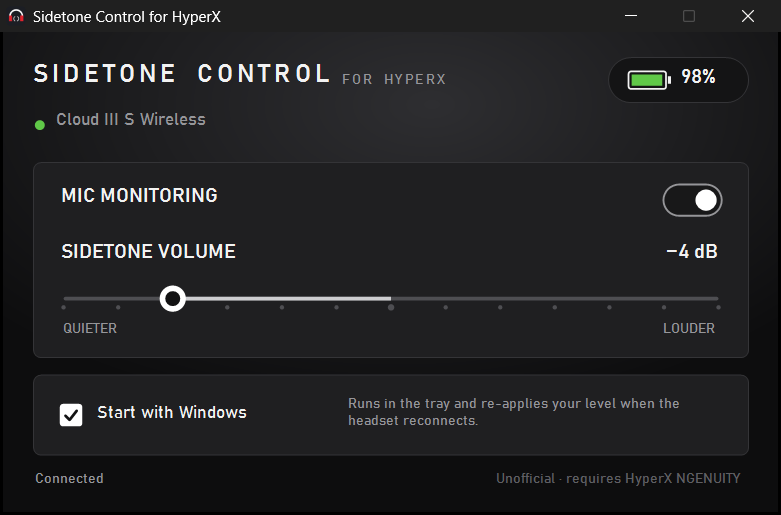

# Sidetone Control for HyperX

Adjust the **sidetone (mic monitoring) volume** of the **HyperX Cloud III S Wireless** from -6 dB to +6 dB.
HyperX NGENUITY only offers an on/off switch for mic monitoring. This app adds the missing volume slider.



The level is applied **inside the headset**, the same way NGENUITY does it. There is no added latency,
unlike software monitoring such as Windows "Listen to this device" or VoiceMeeter.

## Features
- Sidetone volume from -6 dB to +6 dB in 1 dB steps
- Turn mic monitoring on or off
- Battery level at a glance
- Optional **Start with Windows**: runs in the tray and restores your level whenever the headset reconnects.
  The headset itself forgets the level when it is switched off.

## Requirements
- Windows 10 (1809 or newer) or Windows 11
- HyperX NGENUITY desktop app (from [hyperx.com](https://hyperx.com)), installed and running
- HyperX Cloud III S Wireless connected through its USB dongle

## Download
Get `SidetoneControlForHyperX-<version>.zip` from [Releases](../../releases), unzip it and run `SidetoneControl.exe`.
No installation is needed. The download is not code-signed, so Windows SmartScreen may warn about an unknown
publisher. Choose **More info → Run anyway**. Compare the file with `SHA256SUMS.txt` if you want to verify it.

## How it works
NGENUITY consists of a UI and a local background service (`hxn-srv-communication-hub`) that talks to the headset.
Sidetone Control starts a small helper on the .NET runtime that NGENUITY installs. The helper uses NGENUITY's own
`CommunicationHubManager` to send the same `AudioInputMonitoringLevel` command that NGENUITY has built in for
this headset but does not show in its UI.

- `src/App.cs`: the UI (Windows Forms on the .NET Framework that ships with Windows)
- `src/Helper.cs`: the helper that talks to NGENUITY's service on localhost
- `msix/`: Microsoft Store package manifest and submission notes

## Build
No .NET SDK needed. The C# compiler that ships with Windows is enough.

```powershell
powershell -ExecutionPolicy Bypass -File build.ps1        # dist\SidetoneControlForHyperX-<version>.zip
powershell -ExecutionPolicy Bypass -File build-msix.ps1   # Store package; also needs makeappx.exe from the Windows SDK
```

## Privacy
No telemetry, no internet connections, no data collection. See [PRIVACY.md](PRIVACY.md).

## Disclaimer
Unofficial community tool. Not affiliated with, endorsed by, or supported by HyperX or HP Inc.
HyperX and NGENUITY are trademarks of HP Inc. An NGENUITY update can change its internals and break this app.
The app then shows an error, and NGENUITY keeps working normally.

## License
[MIT](LICENSE)
